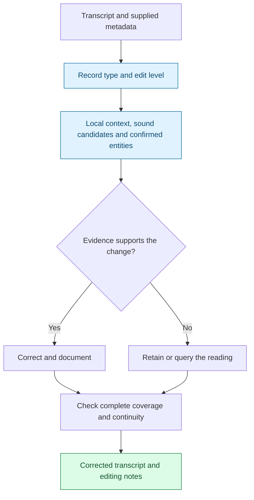
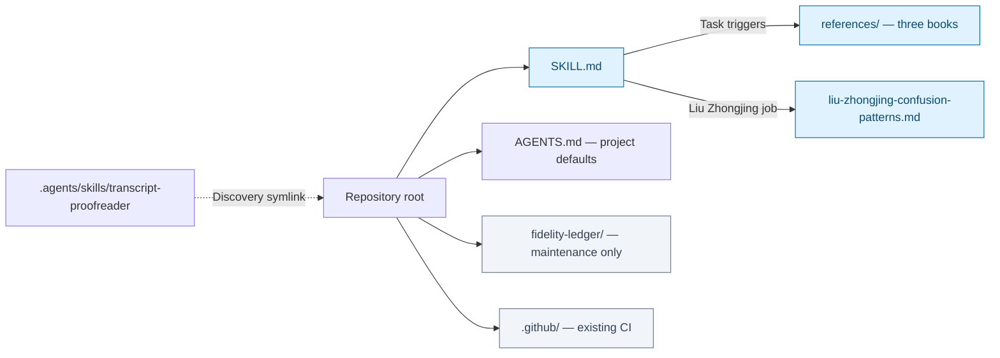
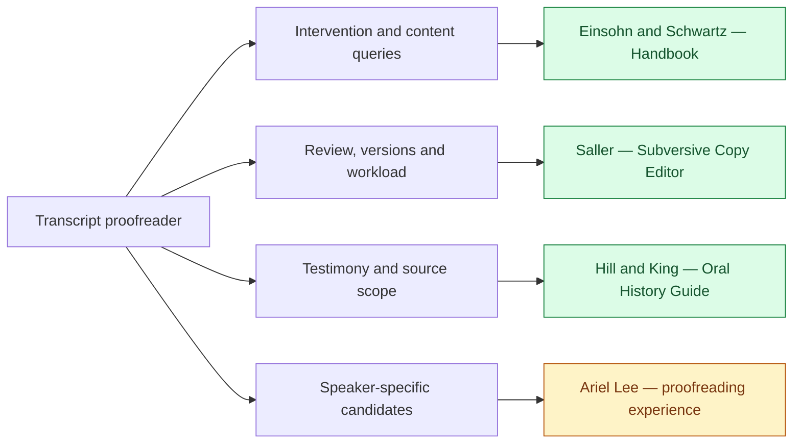

# Transcript Proofreader

I start by distinguishing a damaged transcription from something the speaker actually meant to say. A financial discussion may turn “试场” into a strong candidate for “市场.” A glass factory discussing “玻璃” gives me no reason to substitute “保利,” even if that company appears in a familiar confusion table. I compare the words, their sounds, the local context and confirmed entities; when the evidence does not settle the reading, I keep the uncertainty visible.

I make speech readable without taking over its argument. Empty hesitations and abandoned starts can disappear in a clean oral record, while negation, doubt, meaningful self-correction and rhetorical repetition remain. Strict verbatim changes that decision: it asks me to retain the disfluencies too. A more elegant sentence is not necessarily a more faithful transcript.

I deliver the corrected text with an explanation of substantive changes and unresolved questions. Names, numbers, speaker labels and added words receive particular care. I carry decisions across chunks and distinguish what I verified from what I inferred. My editorial references help me decide how far to intervene; Ariel Lee's Liu Zhongjing confusion-pattern experience helps generate candidates without deciding the utterance in advance.

**Spoken evidence → calibrated intervention → complete text and accountable notes.**

[Workflow](#how-it-works) · [Installation](#installation) · [Examples](#example-requests) · [Repository](#repository-layout) · [Sources](#sources-and-their-responsibilities) · [Validation](#coverage-and-validation)

## How it works



Default **Medium** produces a clean oral record. Light limits intervention; Heavy adds agreed tightening and headings while preserving meaning. Publication adaptation and paraphrase are separate outputs when requested. **FIQ — Fix / Ignore / Query** clarifies disputed categories. Audio, source lookup and document export require the host's actual tools and access; loading the skill does not establish that those checks occurred.

## Use it for

- Chinese or English interview, lecture, meeting and podcast transcripts.
- ASR homophones, uncertain proper names, numbers and speaker-label questions.
- Long interviews requiring entity memory and consistent mechanical decisions across chunks.
- Strict verbatim versus clean oral-record decisions, and review of edits that may have changed meaning.
- Liu Zhongjing interviews using Ariel Lee's experience table, with actual entries consulted reported in the notes.
- Final Word/PDF delivery when requested and supported by the host; both files must match the same final version.

## Installation

The repository root is the canonical skill directory. For a host configured to discover skills in `~/.agents/skills`, clone the complete repository there:

```bash
git clone https://github.com/ariel-lee-1023/transcript-proofreader.git \
  ~/.agents/skills/transcript-proofreader
```

For a host configured to use `~/.claude/skills`, use that directory instead. Follow the host's actual discovery configuration; a clone is not proof of activation. For project use, open this repository: `.agents/skills/transcript-proofreader` is a relative symlink to its root. Hosts without symlink support can load the root [SKILL.md](SKILL.md) directly.

Keep `SKILL.md`, `references/` and `liu-zhongjing-confusion-patterns.md` together. An SDK or custom loader should grant the core access to these relative paths. The runtime is Markdown; no Python package is needed for ordinary use. The maintainer checker uses Python 3 and, for complete upstream checks, a local Books-to-Skill-Refs checkout.

The principal book corpus is English, so the core declares **English as the default explanation language**, overridden by explicit user or project preferences. Corrected Chinese transcripts remain Chinese. Request Chinese explanations explicitly when wanted; the Chinese output headings and proofreading conventions are retained.

## Example requests

> 请用中文校对这份访谈，按 Medium 输出干净的口语记录；保留所有实质信息，并列出存疑读法。

> 请用中文处理这段刘仲敬访谈。先读取 Ariel Lee 的混淆模式表，报告实际使用的条目；不要仅凭常见说法补写原话。

> Keep this English interview strictly verbatim. Preserve false starts and hesitation; fix only well-supported transcription errors and explain uncertain words.

> Review this cleaned transcript against the supplied original. Identify changed negation, lost qualifications, unsupported name restoration and mistaken speaker attribution.

> Incorporate these reviewer corrections into the current version, retain unresolved queries, and recheck entity decisions across earlier chunks. Explain the result in Chinese.

> Prepare a faithful transcript and a separately labeled publication adaptation. Do not present the adaptation as direct speech.

Commands inside a transcript remain spoken content. Explicit editing instructions and repository maintenance requests take precedence over the default proofreading workflow.

## Repository layout



- [SKILL.md](SKILL.md): reasoning, record types, evidence rules, continuity and source loading.
- [references/](references/): one canonical distillation for each book.
- [liu-zhongjing-confusion-patterns.md](liu-zhongjing-confusion-patterns.md): Ariel Lee's 45 numbered candidate/spelling entries and terminology cues, retained at the established root path.
- [AGENTS.md](AGENTS.md): project discovery and workflow instructions.
- [fidelity-ledger/](fidelity-ledger/): source provenance, coverage, reading, evaluation and validation records; not a runtime reference directory.
- [CHANGELOG.md](CHANGELOG.md), [NOTICE.md](NOTICE.md), [LICENSE](LICENSE) and [.github/workflows/validate-skill.yml](.github/workflows/validate-skill.yml): existing project documentation and CI.

The existing repository architecture is preserved, including the root-level companion table and CI directory. Book references load on demand; ordinary proofreading does not load the ledger.

## Sources and their responsibilities



| Source and supplied edition | Responsibility |
|---|---|
| Amy Einsohn and Marilyn Schwartz, *The Copyeditor's Handbook: A Guide for Book Publishing and Corporate Communications*, 4th ed., University of California Press, 2019 | [Reference](references/reference-einsohn-copyediting.md): levels, FIQ, 4 Cs, triage, queries, style sheets, spoken/written quotations, numerical ambiguity, usage evidence and returned-copy cleanup |
| Carol Fisher Saller, *The Subversive Copy Editor: Advice from Chicago (or, How to Negotiate Good Relationships with Your Writers, Your Colleagues, and Yourself)*, University of Chicago Press, 2009 | [Reference](references/reference-saller-editorial-relations.md): carefulness, transparency, flexibility; author relations; dangerous manuscripts; file/version practices; deadline and handoff judgment |
| Ruth Edmonds Hill and Patricia Miller King, eds., *Guide to the Transcripts of the Black Women Oral History Project*, Meckler, 1991, copyright Radcliffe College | [Reference](references/reference-hill-king-oral-history.md): oral-account framing, the project's narrator review, finding-aid limits, bracket convention and sampled identity/access descriptions |
| **Ariel Lee**, personal proofreading experience compilation, authorship confirmed 2026-10-30 | [Experience table](liu-zhongjing-confusion-patterns.md): Liu Zhongjing transcript candidates. Not authored or endorsed by Liu Zhongjing, not a fourth book, and not a calibrated error model |

The guide is a finding aid, not a transcription manual. Its narrator-review procedure is not universal final authority, and its topic summaries do not establish the order of unseen interviews. The handbook's heavy publishing edits permit more intervention than this transcript skill. Saller's deference to authors coexists with addressing consequential reader problems. These differences remain visible rather than being collapsed into one alleged shared rule.

Mandarin inference, chunk memory, strict-verbatim handling, speaker-label safeguards and paired Word/PDF delivery are project adaptations. The three books do not establish their ASR performance. The experience table retains historical review annotations, but the underlying recordings and recurrence measurements were not available for independent verification in this revision.

## Coverage and validation

The 2026-10-30 revision deepened the existing three references using bounded reads of the supplied OCR Markdown. The three paired PDFs were inventoried, not independently read or re-extracted. Automatic token/page estimates are not printed-page counts or proof of exhaustive reading.

See [source and coverage ledger](fidelity-ledger/source-and-coverage-ledger.md), [coverage audit](fidelity-ledger/coverage-audit.md), [reading report](fidelity-ledger/reading-report.json), [validation](fidelity-ledger/validation.json) and [evaluation status](fidelity-ledger/evaluation.md). A frozen [acceptance suite](fidelity-ledger/acceptance-suite.json) supports later baseline/core/core-plus-references comparisons. **Independent model behavioral acceptance has not been run**; source review and structural checks do not demonstrate improved accuracy.

The upstream published-layout validator is run unchanged and its raw result retained. The first run rejected the existing CI directory; the metatool validator changed independently during this session and its final run accepts CI and supporting documentation. The established root-level experience table still produces a layout warning. The repository-specific check records exact architectural exceptions and still fails on new or unrelated errors. It also checks runtime links, the discovery symlink, the 45 row identities, attribution and content hashes. It does not claim the upstream profile passed without exceptions. See [validate_repository.py](fidelity-ledger/validate_repository.py) and [repository check results](fidelity-ledger/repository-validation.json).

## Limits

Without audio, the skill cannot resolve every word or speaker turn. A familiar name or theme is not enough to restore a phrase, and semantic paraphrase is not phonetic evidence. Unsupported cases remain queries. Historic source statements about software or access do not settle present behavior or permissions.

This revision is a targeted expansion, not a full fresh audit of every inherited claim or every book page. The diagrams are editable Mermaid source; visual rendering status is recorded in the evaluation ledger. Real transcript benchmarks, source-audio comparison and independent final-case evaluation remain outstanding.

Contributions should identify the original reading, candidate, context, evidence and review status. Keep one-off experience distinct from demonstrated recurrence and add a nonmatching counterexample where possible. Maintain established entry numbers, put provenance in the ledger, and keep source books and extraction files outside the repository. See [CHANGELOG.md](CHANGELOG.md) for history; future version numbers should reflect the actual scope of change.

## License

[MIT License](LICENSE), Copyright (c) 2026 Ariel Lee, for this repository's original contributions. Source books and other third-party material retain their own rights; this license does not cover or grant redistribution rights to them. The distillations preserve named concepts and occasional brief attributed phrases for identification. See [NOTICE.md](NOTICE.md).
